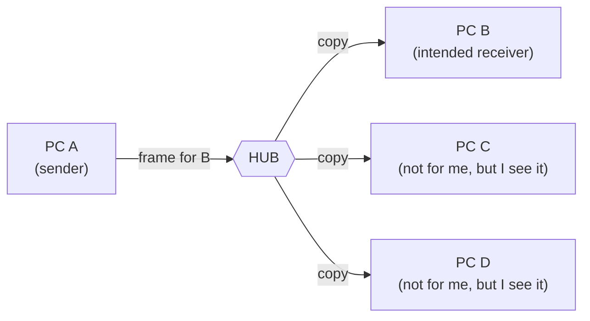
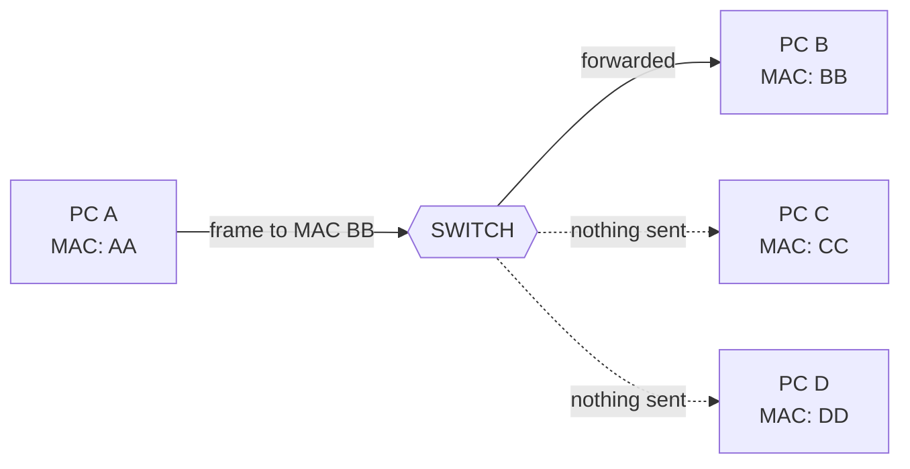
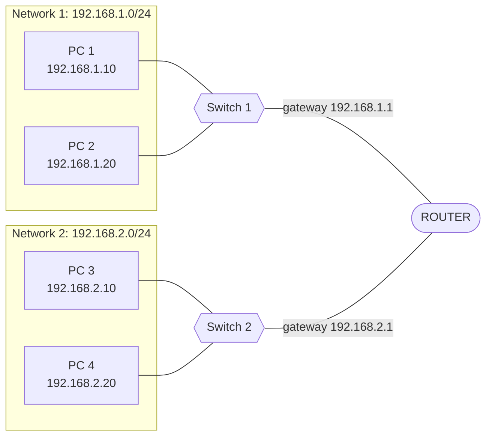
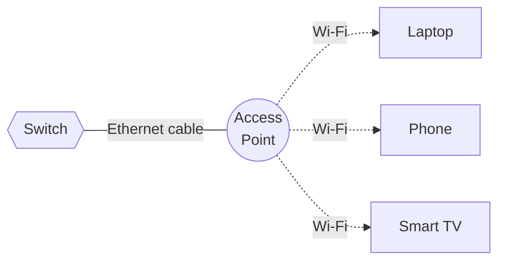
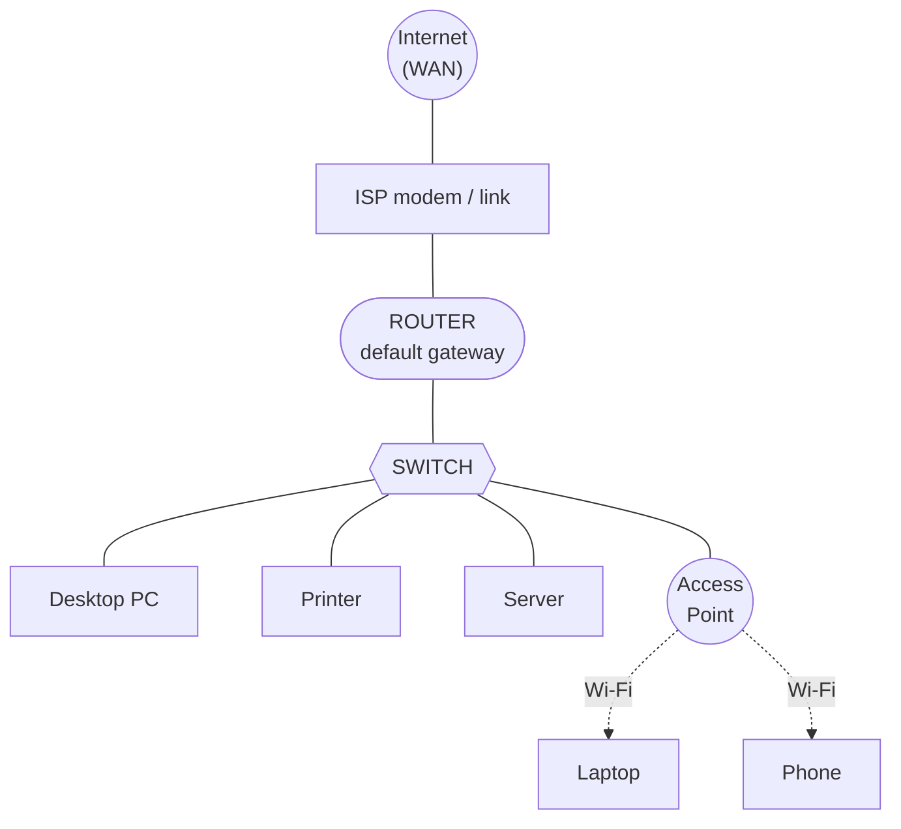

# Hubs vs Switches vs Routers vs Access Points

**Date:** 2026-10-21
**Topic:** Networking fundamentals: network devices and their roles
**Builds on:** LAN vs WAN, MAC vs IP addresses, ARP

---

## The one-sentence version

| Device | One-line job |
|---|---|
| **Hub** | Repeats everything to everyone (obsolete) |
| **Switch** | Delivers data to the right device *inside* a network |
| **Router** | Connects *different* networks and picks the path between them |
| **Access Point (AP)** | Lets Wi-Fi devices join the wired network |

---

## 1. Hub: the "shout to everyone" device

A hub has no intelligence. Whatever comes in one port is copied out of **every other port**.

**Problems:**
- **No privacy:** every device sees all traffic.
- **Collisions:** all ports share one *collision domain*, so devices must take turns.
- **Slow as it grows:** more devices means more contention.

**Status:** obsolete. Replaced by switches. Still appears in exam questions as the contrast case.

---

## 2. Switch: the "deliver to the right door" device

A switch learns which **MAC address** lives on which **port** and forwards each frame only where it needs to go.

### How it learns: the MAC address table

| Port | MAC address |
|---|---|
| Fa0/1 | AA |
| Fa0/2 | BB |
| Fa0/3 | CC |
| Fa0/4 | DD |

1. A frame arrives. The switch records the **source MAC** and the port it came from.
2. It looks up the **destination MAC** in the table.
3. **Known:** forward out that one port only.
4. **Unknown (or broadcast):** flood out all ports except the one it arrived on. This is what happens with an ARP request.

**Key facts:**
- Works at **Layer 2** (MAC addresses).
- **Each port is its own collision domain**, so many conversations run at once at full speed.
- Does **not** route between networks. A switch alone cannot reach the internet.

---

## 3. Router: the "connect networks and pick the path" device

A router connects **separate networks** and forwards packets based on the **destination IP address**.

**What the router does with each packet:**
1. Reads the destination **IP address**.
2. Checks its **routing table**: which network is this on, and which way do I send it?
3. Forwards it out the correct interface.
4. **Rewrites the MAC addresses** for the next hop (the IP addresses stay the same end to end).

**Key facts:**
- Works at **Layer 3** (IP addresses).
- **Each interface is its own broadcast domain**, so broadcasts (like ARP) do not cross a router.
- Is the **default gateway** for devices on its network: the exit door to everything else.
- Connects your **LAN to the WAN** (the internet).

---

## 4. Access Point: the "wired to wireless bridge"

An AP connects Wi-Fi devices to the wired network. It does not route or assign addresses by itself.

**Key facts:**
- Works at **Layer 2**. It converts between Wi-Fi frames and Ethernet frames.
- Wireless devices end up on the **same LAN** as wired ones.
- Plugs into a switch. Big offices use many APs for coverage, all on the same network.

---

## 5. Putting it all together: a real network

**Following a request from the laptop to a website:**
1. Laptop sends data over Wi-Fi to the **AP**.
2. AP passes it onto the wired network to the **switch**.
3. Switch sees the destination MAC is the router's and forwards it to the **router**.
4. Router sees the destination IP is outside the LAN and sends it to the **ISP**, then the internet.
5. The reply comes back the same way.

> **Home networks:** your single "home router" box is usually a **router + switch + access point (+ modem)** in one device.

---

## Comparison table

| | Hub | Switch | Router | Access Point |
|---|---|---|---|---|
| **OSI layer** | 1 (Physical) | 2 (Data Link) | 3 (Network) | 2 (Data Link) |
| **Uses** | Nothing (electrical signal) | MAC addresses | IP addresses | MAC addresses |
| **Sends data to** | All ports | Specific port | Specific network | Wireless clients |
| **Collision domains** | 1 for all ports | 1 per port | 1 per interface | n/a |
| **Broadcast domains** | 1 | 1 (all ports) | 1 per interface | same as its switch |
| **Connects** | Devices in one segment | Devices in one LAN | Different networks | Wi-Fi to wired LAN |
| **Used today?** | No | Yes | Yes | Yes |

---

## Common confusions

- **"Switch vs router?"** A switch moves data *within* a network. A router moves data *between* networks.
- **"Is my Wi-Fi router an access point?"** It contains one, but it also contains a router and a switch.
- **"Why not just use a hub?"** It floods everything everywhere and causes collisions, so it does not scale.
- **"Does a switch need an IP address?"** Not to forward traffic. (Managed switches get one only so you can configure them.)

---

## Quick self-check

1. Which device forwards based on MAC addresses, and which on IP addresses?
2. Why can't two separate LANs talk to each other with only a switch?
3. What happens when a switch receives a frame for a MAC address it hasn't learned yet?
4. Why don't ARP broadcasts reach the internet?

Answers

1. Switch: MAC. Router: IP.
2. A switch only operates within one network. Connecting different networks requires a router.
3. It floods the frame out all ports except the one it arrived on.
4. Routers do not forward broadcasts, so they stay inside the local network.

---

## Related notes

- LAN vs WAN
- MAC vs IP addresses
- ARP and the ARP table
- Lab: Packet Tracer, 2 PCs + switch ping test
