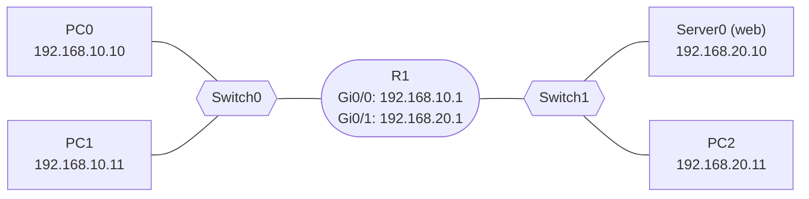

# Access Control Lists (ACLs): Filtering Traffic

**Date:** 2026-11-17
**Tool:** Cisco Packet Tracer
**Builds on:** routing, wildcard masks (OSPF, NAT), TCP/UDP ports, NAT

---

## Goal

Understand how a router filters traffic with ACLs, the difference between standard and extended ACLs, and build a lab that blocks a whole network with a standard ACL, then blocks only one service with an extended ACL.

---

## 1. What an ACL is

Until now, every router forwarded anything it had a route for. An **ACL (Access Control List)** lets a router **filter** traffic: allow some packets and block others, based on rules.

**Analogy: a bouncer with a guest list.** The bouncer checks each person against the list from the top, and stops at the first line that matches.

### Three rules to remember

| Rule | Meaning |
|---|---|
| **Top-down, first match wins** | The router stops at the first rule that matches and ignores the rest |
| **Implicit deny at the end** | If no rule matches, the packet is dropped. This hidden rule is always there and never appears in the config |
| **Order matters** | A broad rule placed above a specific one hides it |

### What ACLs are used for

| Use | Example |
|---|---|
| Block a group from a resource | Stop guests reaching the finance subnet |
| Allow only specific services | Permit web traffic, deny everything else |
| Restrict remote access | Only the admin PC may SSH into the router |
| Select traffic for other features | The NAT lab's `access-list 1` used the same syntax to choose which addresses to translate |

---

## 2. Standard vs extended ACLs

| | Standard ACL | Extended ACL |
|---|---|---|
| Filters on | **Source IP address only** | Source IP, **destination IP**, **protocol** and **ports** |
| Number ranges | 1 to 99, 1300 to 1999 | 100 to 199, 2000 to 2699 |
| Precision | Coarse: block a source from everything | Precise: block one source from one service |
| Placement | Near the **destination** | Near the **source** |
| Analogy | The bouncer checks who you are | The bouncer checks who you are, where you are going and what you want to do |

### Why the placement rule differs

- A standard ACL cannot see the destination. Near the source it would block that source from **everything**, so it goes near the destination.
- An extended ACL is specific, so it goes near the source, where unwanted traffic can be dropped before it crosses the network.

### Wildcard masks

ACLs use wildcard masks, the inverse of a subnet mask. A `0` bit means "must match" and a `1` bit means "ignore".

| Subnet mask | Wildcard mask | Matches |
|---|---|---|
| 255.255.255.0 | 0.0.0.255 | A whole /24 |
| 255.255.255.252 | 0.0.0.3 | A /30 |
| 255.255.255.255 | 0.0.0.0 | One exact host |

Shortcuts: `host 192.168.1.5` means `192.168.1.5 0.0.0.0`, and `any` means `0.0.0.0 255.255.255.255`.

### Applying an ACL

| Direction | Meaning |
|---|---|
| **in** | Filters packets entering the interface, before the routing decision |
| **out** | Filters packets leaving the interface, after the routing decision |

Direction is from the router's point of view. An ACL does nothing until it is applied with `ip access-group`. Only one ACL is allowed per interface, per direction, per protocol. An outbound ACL does not filter traffic the router itself originates.

---

## 3. Lab topology



| From | Port | To | Port |
|---|---|---|---|
| PC0 | FastEthernet0 | Switch0 | Fa0/1 |
| PC1 | FastEthernet0 | Switch0 | Fa0/2 |
| Switch0 | Fa0/24 | R1 | Gi0/0 |
| R1 | Gi0/1 | Switch1 | Fa0/24 |
| Switch1 | Fa0/1 | Server0 | FastEthernet0 |
| Switch1 | Fa0/2 | PC2 | FastEthernet0 |

### Addressing plan

| Device | Network | IP address | Gateway |
|---|---|---|---|
| PC0 | Sales | 192.168.10.10/24 | 192.168.10.1 |
| PC1 | Sales | 192.168.10.11/24 | 192.168.10.1 |
| PC2 | Engineering | 192.168.20.11/24 | 192.168.20.1 |
| Server0 | Engineering | 192.168.20.10/24 | 192.168.20.1 |
| R1 Gi0/0 | Sales gateway | 192.168.10.1/24 | n/a |
| R1 Gi0/1 | Engineering gateway | 192.168.20.1/24 | n/a |

No routing protocol is needed, since both networks are directly connected to R1.

---

## 4. Configuration

### Baseline (R1)

```
hostname R1
interface gi0/0
 ip address 192.168.10.1 255.255.255.0
 no shutdown
interface gi0/1
 ip address 192.168.20.1 255.255.255.0
 no shutdown
```

### Standard ACL: block sales from engineering

```
access-list 10 deny 192.168.10.0 0.0.0.255
access-list 10 permit any
interface gi0/1
 ip access-group 10 out
```

| Line | Meaning |
|---|---|
| `access-list 10 deny 192.168.10.0 0.0.0.255` | Drop packets whose source is anywhere in the sales network |
| `access-list 10 permit any` | Allow everything else. Without it, the implicit deny blocks all traffic |
| `ip access-group 10 out` | Apply to packets leaving Gi0/1, toward engineering (near the destination) |

### Extended ACL: block only the web page

```
ip access-list extended BLOCK-WEB
 10 deny tcp 192.168.10.0 0.0.0.255 host 192.168.20.10 eq 80
 20 permit ip any any
interface gi0/0
 ip access-group BLOCK-WEB in
```

| Part | Meaning |
|---|---|
| `deny tcp` | Block TCP traffic |
| `192.168.10.0 0.0.0.255` | From the sales network |
| `host 192.168.20.10` | To this one host, the server |
| `eq 80` | Destination port 80 (HTTP) |
| `permit ip any any` | Everything else is still allowed |
| `ip access-group BLOCK-WEB in` | Applied on Gi0/0 to packets entering from sales (near the source) |

### Verification commands

| Command | Shows |
|---|---|
| `show access-lists` | Every ACL, with a **match counter** beside each rule |
| `show ip interface gi0/1` | Which ACL is applied, and in which direction |
| `show running-config` | The ACL and `ip access-group` lines |

---

## 5. Results

### Baseline

Before any ACL, PC0 could ping the server and PC2, and the server's web page loaded. This matters: **if something fails later, the ACL caused it, not the routing.**

### Standard ACL

| From | Test | Result | Why |
|---|---|---|---|
| PC0 | Ping the server | Fails | The packet leaves Gi0/1 with a sales source address |
| PC0 | Ping PC2 | Fails | Same reason |
| PC0 | Ping its own gateway `192.168.10.1` | Works | It never leaves through Gi0/1 |
| PC2 | Ping the server | Works | It stays inside engineering and never crosses R1 |
| PC2 | Ping PC0 | **Fails** | The request arrives, but PC0's **reply** has a sales source and is dropped leaving Gi0/1 |

An ACL does not know whether a packet is a reply, so blocking one direction can break return traffic too.

`show access-lists` showed a match counter on the `deny` line that rose with each blocked test.

### Extended ACL

| From PC0 | Result |
|---|---|
| Ping the server | Works |
| Ping PC2 | Works |
| Web page at `http://192.168.20.10` | **Fails to load** |

Pings worked but the web page did not. A standard ACL could only have blocked everything or nothing, which is the reason extended ACLs exist. The counter on `deny tcp ... eq 80` rose when the page was requested, and the counter on `permit ip any any` rose from the pings.


---

## 6. Break-it exercises

> Confirm each against your own results before publishing.

### Implicit deny

Deleting the `permit ip any any` line (`no 20`) leaves only the `deny` rule. Everything fails, including a ping from PC0 to its own gateway, because the ACL is applied inbound on Gi0/0 and checks every IP packet entering from sales, even one addressed to the router. The implicit deny catches whatever the visible rules do not. Restoring the `permit` line fixes it.

### Rule order

Inserting `5 permit ip any any` above the deny makes the router match the permit first, so the deny at rule 10 is never reached, the web page loads, and its match counter stops rising. Removing the broad rule (`no 5`) restores the block.

---

## 7. Common mistakes and troubleshooting

| Symptom | Likely cause |
|---|---|
| Nothing is blocked | The ACL is not applied, or is on the wrong interface or direction |
| Everything is blocked | The `permit` line is missing (implicit deny), or sits below a broader deny |
| The web page still loads | Wrong address or port in the deny rule, or the ACL is in the wrong direction |
| `% Invalid input` | A typo, or the wrong mode: named ACL rules go inside `ip access-list extended ...` |
| Wrong hosts matched | A subnet mask used where a wildcard mask belongs |
| A standard ACL blocks too much | It was placed near the source |
| The baseline fails before any ACL | Routing, cabling or gateway problem |

### Debugging order

1. Does the traffic work **without** the ACL? Rule out routing first.
2. `show ip interface` to confirm the ACL is applied, on the right interface and direction.
3. `show access-lists` and watch whether the counters rise when you test.
4. Read the rules **top to bottom**, the way the router does.
5. Check for the implicit deny.

### Editing a named ACL

Named ACLs use sequence numbers. To insert a rule between two others, give it a number between theirs (such as `15`). To delete one, use `no 10`. Named ACLs are easier to read and edit than numbered ones.

---

## 8. Key takeaways

1. An ACL is an ordered permit/deny list. **The first match wins**, and an **implicit deny** sits at the end.
2. **Standard** filters on source only (1 to 99), placed near the **destination**. **Extended** filters on source, destination, protocol and port (100 to 199), placed near the **source**.
3. Wildcard masks are inverted subnet masks.
4. The list does nothing until applied with `ip access-group in` or `out`.
5. An ACL does not recognise replies, so one-directional blocking can break return traffic.
6. `show access-lists` counters are the best debugging tool.
7. Always test the baseline first, so you know the ACL is what changed.

---

## 9. Self-check

1. A packet from `192.168.10.5` matches `deny 192.168.10.0 0.0.0.255`, which sits above `permit any`. What happens?
2. An ACL has a single `deny host` line and is applied. What happens to other hosts?
3. Why does a standard ACL go near the destination?
4. Which wildcard mask matches all of `192.168.10.0/24`?
5. Why did PC2's ping to PC0 fail after the standard ACL was applied outbound on Gi0/1?
6. How do you find out which rule a packet is hitting?

<details>
<summary>Answers</summary>

1. It is denied, because the first matching rule wins and the router never reaches `permit any`.
2. They are denied too, because of the implicit deny at the end.
3. A standard ACL cannot see the destination, so near the source it would block that source from everything.
4. `0.0.0.255`.
5. The request reached PC0, but PC0's reply carries a sales source address and is dropped as it leaves Gi0/1.
6. `show access-lists`, and check which rule's match counter rises while you test.

</details>

---

## 10. Going further (not yet done)

Add these to the lab only once completed.

- **Restrict remote access:** apply a standard ACL to the VTY lines so only the admin PC can SSH to the router (`access-class`).
- **Allow-list approach:** permit only HTTP and DNS from sales, and deny everything else.
- **Logging:** add the `log` keyword to a deny rule and watch the console messages.
- **Established traffic:** use the `established` keyword to allow replies to connections started from inside.
- **ACLs with NAT:** combine this lab with the NAT lab's topology.
