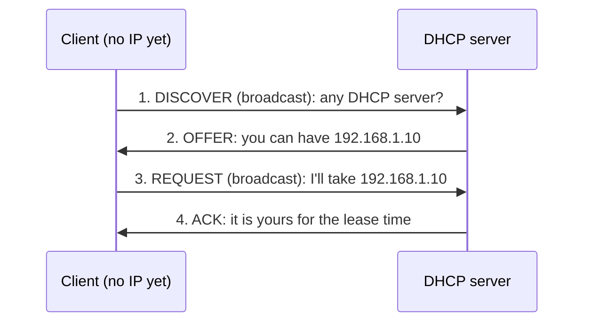
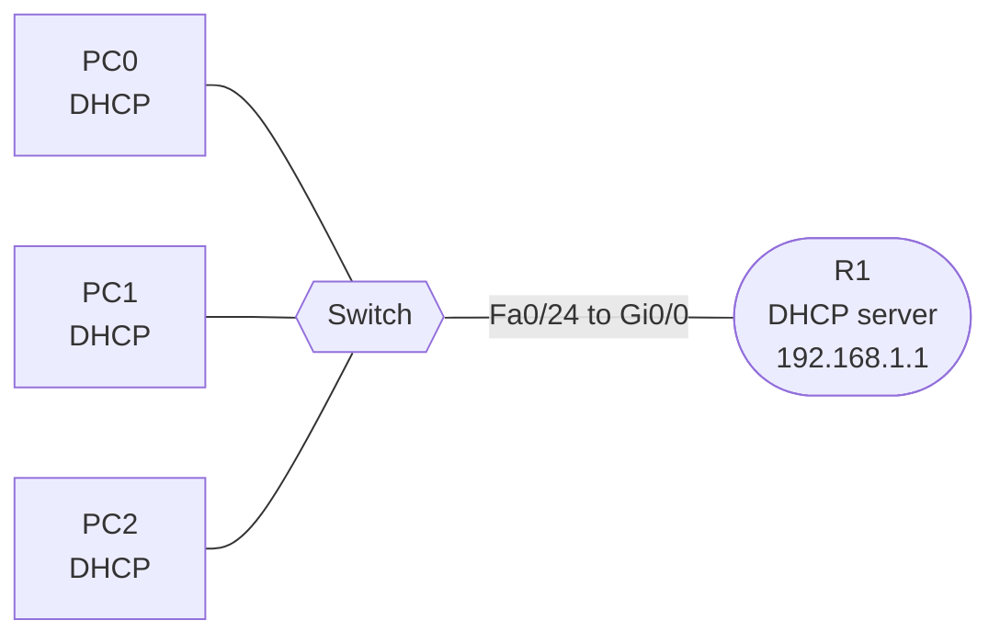

# DHCP: Automatic IP Assignment

**Date:** 2026-11-01
**Tool:** Cisco Packet Tracer
**Builds on:** IP addressing, default gateway, broadcasts, UDP, routers vs switches, VLANs

---

## Goal

Understand how devices get their IP settings automatically, learn the four-step DHCP process (Discover, Offer, Request, Acknowledge), and build a lab where a router acts as the DHCP server, including watching the packets in Simulation mode.

---

## 1. Why DHCP

In earlier labs every PC's IP, mask and gateway was typed by hand. That does not scale: 500 devices means 500 manual configurations, and one typo can cause a duplicate address.

**DHCP (Dynamic Host Configuration Protocol)** gives each device its settings automatically when it joins the network.

**Analogy: hotel check-in.** You arrive with no room (no IP). You ask the whole lobby "is there a front desk?" A desk offers you room 204, you say "I'll take 204," and it confirms and gives you a key card that **expires at checkout**. The checkout time is the **lease**.

### What DHCP provides

| Setting | Why the device needs it |
|---|---|
| IP address | Its identity on the network |
| Subnet mask | Which addresses are local |
| Default gateway | The exit to other networks |
| DNS server | To turn names into IP addresses |
| Lease time | How long the address may be used |

---

## 2. The DORA process



| Step | Sent by | Details |
|---|---|---|
| **D**iscover | Client | Source IP `0.0.0.0`, destination `255.255.255.255`, destination MAC `FF:FF:FF:FF:FF:FF`. UDP port 68 to 67. Every device on the LAN receives it |
| **O**ffer | Server | Proposes an address with mask, gateway, DNS and lease time. The client has no IP yet, so it is reached by its MAC address |
| **R**equest | Client | Accepts **one** offer. It is also a broadcast, so any other server that made an offer knows it was declined |
| **A**cknowledge | Server | Confirms the lease, and the client starts using the address |

If the server cannot honour the request (for example the address was taken in the meantime), it sends a **NAK** and the client starts again with Discover.

### Ports and transport

- Server listens on **UDP 67**. Client uses **UDP 68**.
- DHCP uses **UDP** because the client has no IP address yet, so a TCP connection cannot be set up.

### Leases and renewal

The address is borrowed, not owned.

| Point in the lease | What the client does |
|---|---|
| 50% elapsed (T1) | Asks the same server to renew, by unicast |
| 87.5% elapsed (T2) | If no reply, broadcasts a request to any server |
| 100% (expired) | Stops using the address and starts over with Discover |

On a Windows PC, `ipconfig /release` gives the address back and `ipconfig /renew` requests a new one.

### When DHCP fails: APIPA

If no server answers, Windows self-assigns an address in `169.254.0.0/16`. This is **APIPA**. Seeing `169.254.x.x` on a PC means **"DHCP failed."** The PC can talk to other devices on the same link, but it has no gateway, so it cannot route anywhere else.

### Static vs DHCP

| | Static | DHCP |
|---|---|---|
| Used for | Routers, servers, printers, switches | PCs, phones, laptops, guests |
| Why | Must always be reachable at the same address | Many devices come and go |
| Risk | Typos and duplicate addresses | Needs a reachable server |

Real networks mix both. Infrastructure gets static addresses, and the DHCP pool hands out the rest. Static addresses must be **excluded** from the pool.

---

## 3. Lab topology



| From | Port | To | Port |
|---|---|---|---|
| PC0 | FastEthernet0 | Switch | Fa0/1 |
| PC1 | FastEthernet0 | Switch | Fa0/2 |
| PC2 | FastEthernet0 | Switch | Fa0/3 |
| Switch | Fa0/24 | R1 | Gi0/0 |

---

## 4. Configuration

**Router interface (static, since the server cannot use DHCP itself)**

```
hostname R1
interface gi0/0
 ip address 192.168.1.1 255.255.255.0
 no shutdown
```

**DHCP pool**

```
ip dhcp excluded-address 192.168.1.1 192.168.1.9
ip dhcp pool LAN1
 network 192.168.1.0 255.255.255.0
 default-router 192.168.1.1
 dns-server 8.8.8.8
```

| Line | Meaning |
|---|---|
| `ip dhcp excluded-address 192.168.1.1 192.168.1.9` | Never hand out `.1` to `.9`. This protects the router's own address and leaves room for static devices |
| `ip dhcp pool LAN1` | Creates a pool named LAN1 |
| `network 192.168.1.0 255.255.255.0` | The subnet to hand addresses from |
| `default-router 192.168.1.1` | The gateway given to clients |
| `dns-server 8.8.8.8` | The DNS server given to clients |

The excluded range goes **before** the pool. Otherwise the server could hand the router's own address to a PC.

On each PC: **Desktop, then IP Configuration, then DHCP**.

---

## 5. Lab procedure and checks

### Part 1: Watch DHCP fail, then fix it

1. Build the topology and give R1 its interface address (no DHCP pool yet).
2. Set each PC to **DHCP**. With no server, the PCs fail to get an address and typically show a `169.254.x.x` APIPA address or a failure message.
3. Add the DHCP pool on R1.
4. Make each PC ask again (toggle **Static** then **DHCP**, or run `ipconfig /renew`).
5. Each PC should now receive an address from the pool, along with the mask, gateway and DNS.

Because `.1` to `.9` are excluded, the first address handed out should be `.10`, then `.11`, and so on.

### Part 2: Watch DORA in Simulation mode

1. Click **Simulation** and filter the events to **DHCP** only.
2. On PC0's Command Prompt, run `ipconfig /release` and then `ipconfig /renew`.
3. Step through with **Capture / Forward** and look for the four packets: Discover, Offer, Request, ACK.
4. Open the Discover packet and check the **Source IP (`0.0.0.0`)**, **Destination IP (`255.255.255.255`)**, **Destination MAC (`FFFF.FFFF.FFFF`)** and the **UDP ports (68 to 67)**.

### Verification commands

| Command | What it shows |
|---|---|
| `show ip dhcp binding` | Which MAC got which IP, and when the lease expires |
| `show ip dhcp pool` | Pool size and how many addresses are in use |
| `show ip dhcp conflict` | Addresses found already in use |
| `ipconfig` / `ipconfig /all` (PC) | The address, mask, gateway and DNS the PC received |
| `ipconfig /release` and `/renew` (PC) | Give the address back, and ask again |

---

## 6. Results

> Confirm each item against your own output and screenshots before publishing. Edit anything that differs.

| Check | What the lab should show |
|---|---|
| PCs with no DHCP server | APIPA `169.254.x.x` address or a DHCP failure message |
| PCs after the pool was added | Addresses in `192.168.1.10` and up, mask `255.255.255.0`, gateway `192.168.1.1`, DNS `8.8.8.8` |
| `show ip dhcp binding` | One row per PC: IP address, MAC address, lease expiry |
| `ping 192.168.1.1` from a PC | Replies (the first ping may time out because of ARP) |
| Discover packet | Source `0.0.0.0`, destination `255.255.255.255`, UDP 68 to 67 |
| DORA order | Discover, Offer, Request, ACK |


---

## 7. DHCP across networks: the relay agent

The Discover is a **broadcast**, and **routers do not forward broadcasts**. A DHCP server on a different subnet would never hear it.

A **DHCP relay agent** solves this. On the router interface facing the clients:

```
interface gi0/0
 ip helper-address 10.0.0.50
```

The router converts the client's broadcast into a **unicast to the server** and includes the subnet the request came from, so the server selects the correct pool. One central server can then serve many subnets and VLANs.

This links to the VLAN lab: each VLAN is its own subnet, so each router sub-interface would get an `ip helper-address`, and the server would have one pool per VLAN.

---

## 8. Troubleshooting

| Symptom | Likely cause |
|---|---|
| PC shows `169.254.x.x` | No server reached: check the cable, the VLAN, the pool, or a missing relay |
| Address received but no internet | `default-router` or `dns-server` missing in the pool |
| Duplicate address warnings | A static IP inside the pool range: add it to `ip dhcp excluded-address` |
| Router's own address given to a PC | The excluded-address line was missing or typed after the pool |
| Works on one VLAN but not another | No relay on that VLAN's gateway, or no pool for that subnet |
| No bindings shown | The PCs have not requested yet: run `ipconfig /renew` |
| Pool exhausted | Pool too small, or lease times too long |

**Security note:** a **rogue DHCP server** (for example someone plugging in a home router) can hand out a wrong gateway and capture traffic. Switches defend against this with **DHCP snooping**, which trusts DHCP replies only from designated ports.

---

## 9. Key takeaways

1. DHCP gives a device its IP, mask, gateway, DNS and a **lease**, all automatically.
2. **DORA:** Discover, Offer, Request, Acknowledge. The Discover and the Request are broadcasts.
3. DHCP uses **UDP**, with the server on port **67** and the client on port **68**.
4. A `169.254.x.x` address means DHCP failed.
5. Exclude static addresses (such as the gateway) from the pool.
6. Routers do not forward broadcasts, so a server on another subnet needs **`ip helper-address`**.

---

## 10. Self-check

1. What are the four DHCP messages, and which are broadcasts?
2. Why does DHCP use UDP and not TCP?
3. What source IP does a Discover have, and why?
4. A PC shows `169.254.12.7`. What happened?
5. Why would a DHCP server on a different subnet not hear a client's Discover?

<details>
<summary>Answers</summary>

1. Discover, Offer, Request, Acknowledge. Discover and Request are broadcasts.
2. The client has no IP address yet, so it cannot set up a TCP connection.
3. `0.0.0.0`, because the client has no address yet.
4. DHCP failed and the PC assigned itself an APIPA address.
5. The Discover is a broadcast, and routers do not forward broadcasts. A relay agent (`ip helper-address`) is needed.

</details>

---

## 11. Going further (not yet done)

Add these to the lab only once completed.

- **Relay agent:** put the DHCP server on one router in the OSPF or static routing lab, and add `ip helper-address` on the far router's LAN interface, so clients on the far side still get an address.
- **DHCP per VLAN:** one pool per VLAN, with `ip helper-address` on each router sub-interface.
- **Reservations:** give one device a fixed address using a manual binding.
- **DHCP snooping:** block a rogue DHCP server on the switch.
