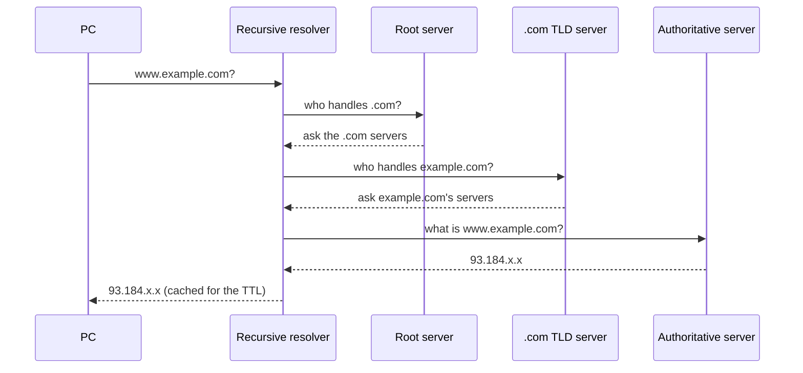
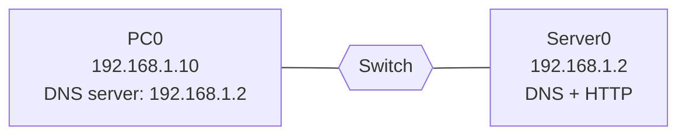

# DNS: Name Resolution

**Date:** 2026-11-15
**Tool:** Cisco Packet Tracer
**Builds on:** IP addressing, DHCP, UDP, default gateway, the "what happens when I type google.com" flow

---

## Goal

Understand how names become IP addresses, how a DNS lookup travels through the DNS hierarchy, and build a lab where a server answers DNS queries, including troubleshooting a failed lookup.

---

## 1. What DNS does

Routers and switches understand IP addresses, but people use names. **DNS (Domain Name System)** turns names into IP addresses.

**Analogy:** the contacts app on a phone. You tap "Mom", and the phone looks up her number. If it does not have the contact, it asks someone who does.

### The hierarchy

A name is read right to left:

```
www  .  example  .  com  .   (root)
 |        |         |        |
host    domain      TLD     root
```

| Level | Example | Role |
|---|---|---|
| Root (`.`) | the invisible final dot | Knows which servers handle each TLD |
| TLD | `.com`, `.org`, `.in` | Knows which servers handle each domain |
| Domain | `example.com` | Owned by an organization |
| Subdomain / host | `www`, `mail` | A specific service or machine |

No single server stores every name. The system is **distributed**: each level knows only who to ask next, which is how it scales to the whole internet.

### Who does what

| Role | What it is |
|---|---|
| **Stub resolver** | The small DNS client built into a PC. It only asks questions |
| **Recursive resolver** | Does the searching on the client's behalf and **caches** answers (ISP DNS, `8.8.8.8`, `1.1.1.1`) |
| **Root server** | Points to the right TLD servers |
| **TLD server** | Points to the right authoritative servers |
| **Authoritative server** | Holds the real records for a domain |

---

## 2. How a lookup works



- **Recursive query:** the PC asks the resolver for the final answer and expects either the answer or an error.
- **Iterative query:** the resolver asks each server in turn, and each replies with a pointer to the next one.

Before asking anyone, a PC checks: the browser cache, the OS cache, and the **hosts file**. Only then does it ask its configured DNS server, which it normally received from DHCP.

### Caching and TTL

Every record carries a **TTL (time to live)** that states how long it may be cached. Caching means most lookups never reach the root or TLD servers, which makes DNS fast. The downside is that when a site changes its IP, some users keep the old answer until the TTL expires.

---

## 3. Record types

| Record | Maps | Example |
|---|---|---|
| **A** | Name to IPv4 address | `www.mylab.com` to `192.168.1.2` |
| **AAAA** | Name to IPv6 address | |
| **CNAME** | A name to another name (alias) | `mail.mylab.com` to `www.mylab.com` |
| **MX** | The mail servers for a domain | |
| **NS** | The authoritative name servers for a domain | |
| **PTR** | IP to name (reverse lookup) | |
| **TXT** | Free text, used for verification | |
| **SOA** | Administrative information about a zone | |

Memory trick: **A** = Address, **MX** = Mail eXchange, **NS** = Name Server, **PTR** = PoinTeR back to the name.

### Ports and transport

| Detail | Value |
|---|---|
| Port | **53** |
| Normally | **UDP**: one small question and one small answer, so a handshake would cost more than the query |
| TCP 53 | Large responses and zone transfers between servers |
| Encrypted DNS | DNS over TLS (853) and DNS over HTTPS (443) |

Regular DNS is not encrypted, so anyone on the path can see which names are looked up.

---

## 4. Lab topology



| Device | IP address | Mask | Gateway | DNS server |
|---|---|---|---|---|
| PC0 | 192.168.1.10 | 255.255.255.0 | none | 192.168.1.2 |
| Server0 | 192.168.1.2 | 255.255.255.0 | none | none |

No gateway is needed because everything is on one LAN.

---

## 5. Configuration

On **Server0**, under **Services**:

1. **DNS:** set the DNS Service to **On**, then add a resource record:

| Field | Value |
|---|---|
| Name | `www.mylab.com` |
| Type | A Record |
| Address | `192.168.1.2` |

Click **Add** so that the record appears in the table. Typing the values without clicking Add creates nothing.

2. **HTTP:** confirm HTTP is **On**. Packet Tracer provides a default web page.

On **PC0**, set the **DNS Server** field (under **Desktop**, then **IP Configuration**) to `192.168.1.2`.

### Test commands

| Command | Purpose |
|---|---|
| `ping 192.168.1.2` | Tests connectivity by IP, with no DNS involved |
| `nslookup www.mylab.com` | Asks the configured DNS server for a name and shows who answered |
| `ping www.mylab.com` | Resolves the name first, then pings |
| Web Browser, `http://www.mylab.com` | Resolves the name, then fetches the page over HTTP |

---

## 6. Troubleshooting log: what failed and how I found it

### Symptom

In the PC's Web Browser, `http://www.mylab.com` showed **"Host Name Unresolved"**, which means the DNS lookup failed before any web request was sent.

### What I checked

On PC0's Command Prompt:

| Command | Result | Conclusion |
|---|---|---|
| `ping 192.168.1.2` | Replies, 0% loss | The network is fine |
| `nslookup www.mylab.com` | `Server: [192.168.1.2]`, then `Non-existent domain` | PC0 is asking the correct server, and the **server answered**, but it has no record for that name |
| `ping www.mylab.com` | "Ping request could not find host" | Same failure at the name step |
| `nslookup www.google.com` | `Non-existent domain` | Expected: this server only knows the records added to it |

### Root cause

The DNS service was reachable and responding, but the **A record for `www.mylab.com` was missing from the table on Server0**. The lookup could not succeed until the record had been added correctly (Name, Type, Address, then **Add**).

### Fix

Added the A record on Server0, then re-ran `nslookup www.mylab.com`, which returned the server's address, and reloaded the web page.

### Reading the three failure modes

| Symptom | What it means |
|---|---|
| Timeout, or "cannot find server" | The PC cannot reach a DNS server (wrong address, no route, or the service is off) |
| **Non-existent domain** | The server answered, but has no record for that name |
| **Host Name Unresolved** (browser) | The lookup failed, so no web request was sent |


### Break it on purpose

> Confirm this part against your own results before publishing it.

Clearing the **DNS Server** field on PC0 should leave `ping 192.168.1.2` working while `ping www.mylab.com` fails. That pair is the signature of a DNS problem: **IP works, name fails**. Restoring the DNS Server field fixes it.

---

## 7. How DNS fits with earlier topics

| Earlier topic | Connection |
|---|---|
| **DHCP** | Hands the PC its DNS server address (the `dns-server` line in a pool) |
| **google.com walkthrough** | DNS is the first step, before ARP, TCP and TLS |
| **UDP** | DNS is the textbook use of UDP, like DHCP |
| **Default gateway** | The DNS server is usually outside the LAN, so queries travel through the router |

---

## 8. Troubleshooting guide

The most useful test is this pair:

```
ping 8.8.8.8        (works)
ping google.com     (fails)
```

| Result | Meaning |
|---|---|
| IP works, name fails | A DNS problem, not a connectivity problem |
| Both fail | A routing or connectivity problem |
| `nslookup` times out | The PC cannot reach its DNS server |
| `nslookup` says non-existent domain | The server answered but has no such record (typo, or the record was never added) |
| Name resolves to the wrong IP | A stale cache, a wrong record, or a hosts-file entry |

| Command | Purpose |
|---|---|
| `nslookup <name>` | Query the configured server |
| `nslookup <name> 8.8.8.8` | Query a specific server |
| `ipconfig /all` | See which DNS server the PC was given |
| `ipconfig /flushdns` | Clear the PC's DNS cache (Windows) |

**Security note:** attackers can attempt DNS spoofing or cache poisoning, feeding a resolver a false answer so users land on a fake site. **DNSSEC** adds signatures so answers can be verified, and DoH/DoT protect lookups in transit.

---

## 9. Key takeaways

1. DNS maps **names to IPs**, using a hierarchy: root, TLD, authoritative.
2. A PC asks a **recursive resolver**, which does the searching and **caches** the answer for the **TTL**.
3. Common records: **A**, **AAAA**, **CNAME**, **MX**, **NS**, **PTR**.
4. DNS uses **UDP 53**, with TCP 53 for large answers.
5. **IP works but name fails** points to DNS.
6. **Non-existent domain** means the server answered with no matching record, which is different from a timeout.
7. Adding a record is two steps: fill in the fields, then click **Add**.

---

## 10. Self-check

1. What is the difference between a recursive resolver and an authoritative server?
2. What does the TTL on a DNS record control?
3. `ping 8.8.8.8` works but `ping google.com` fails. What do you suspect?
4. What does "Non-existent domain" tell you that a timeout does not?
5. Which record type would you use for an alias, and which for mail?

<details>
<summary>Answers</summary>

1. A recursive resolver does the searching on the client's behalf and caches answers. An authoritative server holds the real records for a domain.
2. How long the answer may be cached.
3. DNS: connectivity is fine, but the name is not being resolved.
4. The server was reached and responded, but it has no record for that name. A timeout means the server could not be reached.
5. CNAME for an alias, MX for mail.

</details>

---

## 11. Going further (not yet done)

Add these to the lab only once completed.

- **CNAME record:** add `mail.mylab.com` pointing to `www.mylab.com` and run `nslookup mail.mylab.com`.
- **DHCP and DNS together:** add `dns-server 192.168.1.2` to a DHCP pool so PCs receive the DNS server automatically.
- **Watch the packets:** in Simulation mode, filter to DNS and inspect the query (UDP destination port 53).
- **Two DNS servers:** configure a secondary and test failover.
