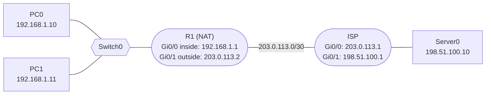

# NAT and PAT: Private Addresses Reaching the Internet

**Date:** 2026-11-16
**Tool:** Cisco Packet Tracer
**Builds on:** IP addressing and subnetting, static routing, default routes, DHCP, TCP/UDP ports

---

## Goal

Understand why NAT exists, how PAT lets many private hosts share one public address, and build a lab that first shows a private address failing to reach an "internet" server, then fixes it with PAT.

---

## 1. Why NAT exists

1. **IPv4 ran out of addresses.** There are about 4.3 billion, far fewer than the number of devices. NAT lets a whole network share one public address.
2. **Private addresses are not routable on the internet.** They are reused inside millions of networks, so they cannot be unique worldwide, and internet routers are built to drop them.

| Private range | Typical use |
|---|---|
| `10.0.0.0/8` | Large organizations |
| `172.16.0.0/12` (172.16.x.x to 172.31.x.x) | Mid-size networks |
| `192.168.0.0/16` | Homes and small offices |

**Analogy: a company switchboard.** A company has one public phone number and many internal extensions. When an employee calls out, the switchboard places the call under the company number and remembers who made it. When the reply comes in, it routes it to the right extension. Outsiders only ever see the company number.

---

## 2. Types of NAT

| Type | Mapping | Used for |
|---|---|---|
| **Static NAT** | One private address to one fixed public address | A server that must be reachable from outside |
| **Dynamic NAT** | Private addresses to a pool of public addresses | Rare today, since it needs many public addresses |
| **PAT** (NAT overload) | Many private addresses to one public address, told apart by **port numbers** | Almost every home and office |

### How PAT works

```
Inside                              NAT router                 Internet
PC1 192.168.1.10:51000  ---->  203.0.113.2:1024  ---------->  server:80
PC2 192.168.1.11:51000  ---->  203.0.113.2:1025  ---------->  server:80
```

The router keeps a **NAT table** that maps each inside address and port to a public address and port. When a reply arrives addressed to `203.0.113.2:1025`, the router looks up port 1025, finds PC2, rewrites the destination back to `192.168.1.11`, and delivers it.

### The four NAT terms

| Term | Meaning | In this lab |
|---|---|---|
| **Inside local** | The inside host's private address, as seen inside | `192.168.1.10` |
| **Inside global** | The inside host's address as seen from outside | `203.0.113.2` |
| **Outside global** | The outside host's real address | `198.51.100.10` |
| **Outside local** | The outside host's address as seen inside (usually the same as outside global) | `198.51.100.10` |

Memory trick: **local** is what the inside network sees, **global** is what the internet sees.

### NAT is the exception to "IPs never change"

In ordinary routing, the IP addresses stay the same end to end and only the MAC addresses change at each hop. **NAT deliberately rewrites the IP address (and port)** as a packet crosses the boundary between inside and outside.

### Limitations

| Limitation | Why |
|---|---|
| Inbound connections are blocked by default | The table only has entries for connections that started from inside. This is a side benefit, not a replacement for a firewall |
| Hosting a service needs port forwarding | A manual mapping from a public port to an inside host |
| Breaks end-to-end addressing | Some protocols embed IP addresses inside their data |
| Adds state and a little delay | The router must track every connection |

---

## 3. Lab topology



### Cabling

| From | Port | To | Port |
|---|---|---|---|
| PC0 | FastEthernet0 | Switch0 | Fa0/1 |
| PC1 | FastEthernet0 | Switch0 | Fa0/2 |
| Switch0 | Fa0/24 | R1 | Gi0/0 |
| R1 | Gi0/1 | ISP | Gi0/0 |
| ISP | Gi0/1 | Server0 | FastEthernet0 |

### Addressing plan

| Device | Interface | IP address | Gateway |
|---|---|---|---|
| PC0 | NIC | 192.168.1.10/24 | 192.168.1.1 |
| PC1 | NIC | 192.168.1.11/24 | 192.168.1.1 |
| R1 | Gi0/0 (inside) | 192.168.1.1/24 | n/a |
| R1 | Gi0/1 (outside) | 203.0.113.2/30 | n/a |
| ISP | Gi0/0 | 203.0.113.1/30 | n/a |
| ISP | Gi0/1 | 198.51.100.1/24 | n/a |
| Server0 | NIC | 198.51.100.10/24 | 198.51.100.1 |

The ISP router deliberately has **no route to `192.168.1.0/24`**, as on the real internet, where private networks are never carried.

---

## 4. Configuration

**R1, before NAT**

```
hostname R1
interface gi0/0
 ip address 192.168.1.1 255.255.255.0
 no shutdown
interface gi0/1
 ip address 203.0.113.2 255.255.255.252
 no shutdown
ip route 0.0.0.0 0.0.0.0 203.0.113.1
```

**ISP**

```
hostname ISP
interface gi0/0
 ip address 203.0.113.1 255.255.255.252
 no shutdown
interface gi0/1
 ip address 198.51.100.1 255.255.255.0
 no shutdown
```

**R1, PAT added**

```
interface gi0/0
 ip nat inside
interface gi0/1
 ip nat outside
access-list 1 permit 192.168.1.0 0.0.0.255
ip nat inside source list 1 interface gi0/1 overload
```

| Line | Meaning |
|---|---|
| `ip nat inside` / `ip nat outside` | Marks which interface faces the private LAN and which faces the internet |
| `access-list 1 permit 192.168.1.0 0.0.0.255` | The private addresses allowed to be translated (a wildcard mask) |
| `ip nat inside source list 1 interface gi0/1 overload` | Translate matching sources to Gi0/1's address. `overload` turns on PAT |

NAT only rewrites addresses. R1 still needs the **default route** to know where to send traffic.

### Verification commands

| Command | Shows |
|---|---|
| `show ip nat translations` | The NAT table: inside local, inside global, outside |
| `show ip nat statistics` | Which interfaces are inside and outside, and the translation count |
| `clear ip nat translation *` | Empties the table, useful when testing |

---

## 5. Results

### Before NAT

| Test | Result | Why |
|---|---|---|
| PC0 to `192.168.1.1` | Works | Same LAN |
| R1 to the server `198.51.100.10` | Works | R1 sends from its public-side address `203.0.113.2`, which the ISP can reply to |
| PC0 to the server | **Fails** | The request arrives from `192.168.1.10`, and the reply cannot return because the ISP has no route to a private network |

### After PAT

PC0's ping to the server succeeded, with nothing changed on the ISP router or the server.

`show ip nat translations` showed the private address mapped to the public one:

| Column | Value |
|---|---|
| Inside local | `192.168.1.10` (PC0's private address) |
| Inside global | `203.0.113.2` (the address the internet sees) |
| Outside | `198.51.100.10` (the server) |

With web requests from both PCs, the table showed two entries sharing the inside global address `203.0.113.2`, with different port numbers, which is PAT. The exact port numbers differ between runs.


### Break it on purpose

> Confirm this part against your own results before publishing it.

Removing `ip nat inside` from Gi0/0 should stop the translation, so pings from the PCs to the server fail and the NAT table stops gaining entries. Restoring the command fixes it.

---

## 6. Troubleshooting guide

| Symptom | Likely cause |
|---|---|
| Internal PCs cannot reach the internet, but the router can | NAT not applied: check that `ip nat inside` and `ip nat outside` are on the **right interfaces** |
| NAT table is empty | The access list does not match the private network, or the interfaces are mislabelled |
| Router has no route to the internet | NAT only rewrites addresses: a **default route** is still required |
| Even the router cannot reach the far side | An addressing or cabling problem on the outside link: `show ip interface brief` and `show cdp neighbors` |
| Worked, then stopped | Check `show ip nat translations` for entries, and that translations have not timed out |

Debug order: PC to gateway, then router to ISP, then the NAT labels and access list, then the default route.

---

## 7. Key takeaways

1. NAT exists because IPv4 addresses ran out and **private addresses are not routable** on the internet.
2. **Static** is one to one, **dynamic** uses a pool, and **PAT (overload)** is many to one using **port numbers**.
3. The router's **NAT table** remembers which inside host owns each translation.
4. **Inside local** is the private address, and **inside global** is the public address.
5. Mark interfaces `ip nat inside` and `ip nat outside`, and do not forget the **default route**.
6. NAT is the one case where a router changes the IP address. Ordinary routing changes only MAC addresses.
7. NAT blocks unsolicited inbound connections by default, but it is not a firewall.

---

## 8. Self-check

1. Why could R1 reach the server but PC0 could not, before NAT?
2. What does the `overload` keyword do?
3. What is the difference between inside local and inside global?
4. Why does R1 still need a default route when NAT is configured?
5. Why can a stranger on the internet not start a connection to PC0?
6. How does the router know which PC a reply belongs to when both share one public address?

<details>
<summary>Answers</summary>

1. R1's packets used its public-side address, which the ISP can reply to. PC0's packets used a private address, and the ISP has no route back to it.
2. It enables PAT: many inside hosts share one public address, distinguished by port numbers.
3. Inside local is the host's private address as seen inside. Inside global is the address the internet sees.
4. NAT only rewrites addresses. The router still needs to know where to send traffic that leaves the network.
5. The NAT table only contains entries for connections that started from inside, so there is nothing to map an unsolicited packet to.
6. It looks up the destination port in its NAT table, which maps each public port to one inside host and port.

</details>

---

## 9. Going further (not yet done)

Add these to the lab only once completed.

- **Static NAT:** map a fixed public address to the server for inbound access, and test from outside.
- **Port forwarding:** forward a public port to an inside host.
- **Dynamic NAT with a pool:** use `ip nat pool` instead of the interface address.
- **NAT with DHCP:** give the inside LAN addresses by DHCP, so a new PC joins and is translated automatically.
- **ACL practice:** reuse this topology to filter traffic with ACLs in the next lab.
