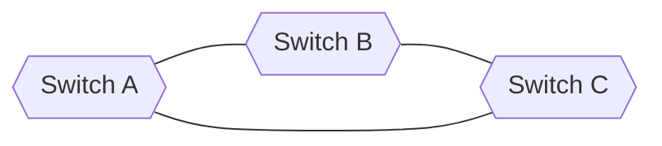
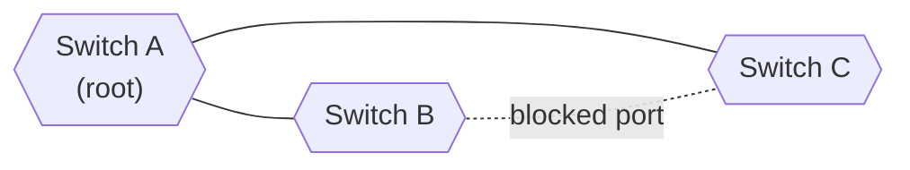
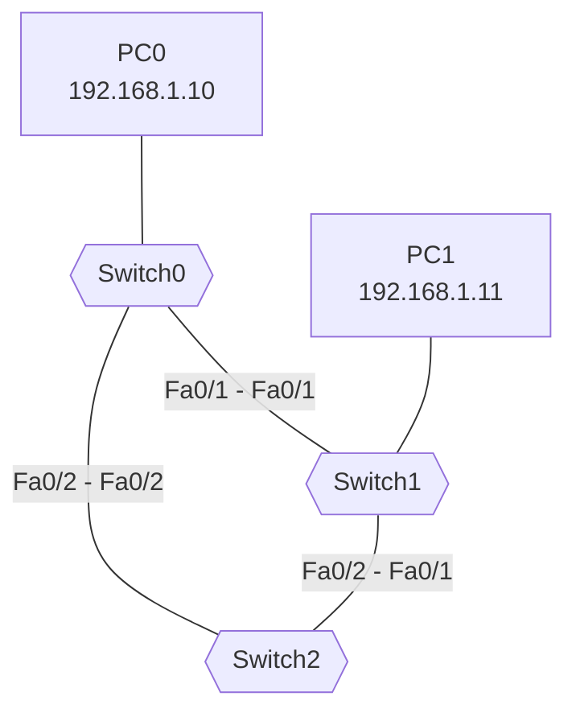

# Switching Loops and the Spanning Tree Protocol (STP)

**Date:** 2026-10-29
**Tool:** Cisco Packet Tracer
**Builds on:** switch forwarding, MAC tables, broadcasts, trunks and redundancy

---

## Goal

Understand how redundant switch links create loops, see STP cut the loop by blocking a port, choose the root bridge deliberately, and watch a blocked port take over when an active link fails.

---

## 1. The problem: Layer 2 loops

Redundant links are good: if one cable fails, another carries traffic. But a ring of switches is a **loop**, and loops are dangerous at Layer 2.



Two facts cause the damage:

1. **Switches flood** broadcasts (and frames for unknown destinations) out every port except the one they arrived on.
2. **An Ethernet frame has no TTL.** An IP packet's TTL counts down and kills it. A frame carries no countdown, so it can circle forever.

### What happens when one broadcast enters a loop

```
A floods the frame to B and to C
B floods it onward to C, and C floods it onward to B
Each switch receives copies from both directions and floods them again
...two copies circle the ring in opposite directions, forever,
   and every pass spills new copies to the PCs
```

| Symptom | Cause |
|---|---|
| Links at 100% | The same frames fill every cable |
| Switch CPU maxed out | Endless processing of the same flood |
| Network unresponsive | Real traffic cannot get through |
| **MAC table flapping** | The same source MAC arrives on different ports, so the switch keeps rewriting its table, which breaks even normal unicast traffic |

### Why this does not happen at Layer 3

IP packets carry a TTL and routers do not forward broadcasts. Switches have neither protection, which is why they need STP.

---

## 2. The solution: Spanning Tree Protocol

> **STP keeps all cables plugged in but blocks certain ports, so the network becomes a loop-free tree. If an active link fails, it unblocks a port.**

Switches exchange **BPDUs** (Bridge Protocol Data Units) every 2 seconds to agree on the tree.



The blocked port is a **standby**. It forwards no data but keeps listening, ready to take over.

---

## 3. How STP decides

### Step 1: Elect the root bridge

Every switch has a **Bridge ID**:

```
Bridge ID = Priority + MAC address
            (default 32768)
```

> **The lowest Bridge ID wins.** Compare priority first. If tied, the lowest MAC wins.

On Cisco switches the VLAN number is added to the priority, so VLAN 1 shows as 32769. With default priorities everywhere, the winner is decided by MAC address, which is effectively luck. In a real network the root is chosen on purpose, on a core switch.

### Step 2: Assign port roles

| Role | Meaning | State |
|---|---|---|
| **Root port** | The one port on a non-root switch with the best path to the root | Forwarding |
| **Designated port** | The best port on each cable segment, facing the root | Forwarding |
| **Alternate (blocked) port** | Everything else, which would close the loop | Blocking |

The **root bridge never blocks a port**: all its ports are designated.

### Path cost

| Link speed | Cost |
|---|---|
| 10 Mbps | 100 |
| 100 Mbps | 19 |
| 1 Gbps | 4 |
| 10 Gbps | 2 |

Costs add up along the path to the root. Lower is better.

### Port states (classic STP)

```
Blocking -> Listening -> Learning -> Forwarding
 (20 s)       (15 s)       (15 s)
```

Classic STP can take 30 to 50 seconds to react to a change. **RSTP** (`spanning-tree mode rapid-pvst`) does the same job in a few seconds and is what modern networks use.

---

## 4. Lab topology



| Cable | Ports |
|---|---|
| Switch0 to Switch1 | Fa0/1 to Fa0/1 |
| Switch1 to Switch2 | Fa0/2 to Fa0/1 |
| Switch2 to Switch0 | Fa0/2 to Fa0/2 |
| PC0 to Switch0 | Fa0/3 |
| PC1 to Switch1 | Fa0/3 |

All three links form the ring. STP is on by default in Packet Tracer.

---

## 5. Observations

### With default settings

`show spanning-tree` on Switch0:

| Item | Value | Meaning |
|---|---|---|
| Bridge ID (own) | 32769, MAC `0030.A331.63B5` | 32768 + VLAN 1 |
| Root ID | 32769, MAC `0005.5EAD.B652` | A different switch was root |
| Why that switch won | Lower MAC, since priorities tied | Tie-break rule |
| Root path cost | 19, via Fa0/2 | One FastEthernet hop to the root |

| Port | Role / State | Meaning |
|---|---|---|
| Fa0/2 | Root, FWD | Best path to the root |
| Fa0/1 | **Altn, BLK** | **The blocked port that breaks the loop** |
| Fa0/3 | Desg, FWD | Faces PC0 |

On the topology, one cable showed an **orange** dot (blocked) and the others green.

### After making Switch0 the root

```
spanning-tree vlan 1 priority 4096
```

| Item | Result |
|---|---|
| Root ID priority | 4097 (4096 + VLAN 1) |
| Status line | **This bridge is the root** |
| All Switch0 ports | `Desg` (the root never blocks) |
| Fa0/1 | Showed `LIS` (Listening) briefly, then moved to forwarding |
| New blocked port | Moved to the **Switch1 to Switch2** link, the one cable not touching the root |

### Failover test

1. Ran a continuous ping from PC0 to PC1.
2. Shut down Switch1's link to the root: `interface fa0/1`, `shutdown`.
3. Pings timed out for a while, then **recovered** as the blocked port moved to forwarding.
4. Restored the link with `no shutdown`.

That pause is the STP reconvergence delay.

### Broadcast storm demonstration

With STP disabled (`no spanning-tree vlan 1` on all three switches), a single broadcast kept circling the ring in Simulation mode and the event list kept growing. Re-enabling STP (`spanning-tree vlan 1`) blocked a port again.


---

## 6. Commands used

| Command | Purpose |
|---|---|
| `show spanning-tree` | Root ID, own Bridge ID, port roles and states |
| `spanning-tree vlan 1 priority 4096` | Make this switch the root (priority must be a multiple of 4096) |
| `spanning-tree vlan 1 root primary` | Shortcut that sets a low enough priority automatically |
| `no spanning-tree vlan 1` | Disable STP for VLAN 1 (lab only, to demonstrate a loop) |
| `spanning-tree vlan 1` | Re-enable STP |
| `spanning-tree mode rapid-pvst` | Use RSTP for fast convergence |

### Protecting edge ports

```
interface fa0/3
 spanning-tree portfast
 spanning-tree bpduguard enable
```

- **PortFast:** an end-device port goes straight to forwarding.
- **BPDU Guard:** if the port ever receives a BPDU (someone plugged in a switch), it shuts down, preventing accidental loops.

---

## 7. Mistakes and lessons

- **Simulation mode freezes STP timers.** After the storm experiment I was still in Simulation mode, so a port stayed orange (Listening) indefinitely. Switching back to **Realtime**, or using Fast Forward Time, let the timers finish.
- **One orange dot is normal; red is a real problem.** Orange means STP is blocking or transitioning a port. Two orange dots after waiting usually means something is still converging.
- **Command syntax:** the option for a continuous ping goes before the address: `ping -t 192.168.1.11`.
- **Two switches with the same hostname** make it easy to configure the wrong one. Check the CLI window title, or set a hostname with `hostname`.

---

## 8. Key takeaways

1. A loop of switches plus flooding plus **no frame TTL** means endless, multiplying frames.
2. STP blocks the minimum number of ports needed to break every loop.
3. **Lowest Bridge ID (priority, then MAC) wins** the root election. Choose the root on purpose.
4. The **root bridge has no blocked ports.** The block lands on the link farthest from the root.
5. The blocked port is a standby. It takes over after a failure, with a delay (classic STP) or quickly (RSTP).
6. Protect edge ports with PortFast and BPDU Guard.

---

## 9. Self-check

1. Why does a loop not cause the same problem with routers?
2. Why would a loop break normal unicast traffic too?
3. Switch X has priority 32768 and MAC `00:11:..`. Switch Y has priority 32768 and MAC `00:22:..`. Which is the root?
4. Why does the root bridge never have a blocked port?
5. What happens to the blocked port when an active link fails?

<details>
<summary>Answers</summary>

1. IP packets have a TTL that kills them, and routers do not forward broadcasts.
2. MAC table flapping gives the switch wrong forwarding information.
3. Switch X: priorities tie, and the lower MAC wins.
4. Every segment it touches is closest to the root, so all its ports are designated.
5. STP recalculates and moves it to forwarding, restoring connectivity after the reconvergence delay.

</details>

---

## 10. What I would do next

- Switch all three switches to RSTP and compare the failover time with classic STP.
- Combine STP with VLANs and look at per-VLAN root bridges (PVST+).
- Replace one redundant link pair with an EtherChannel.
