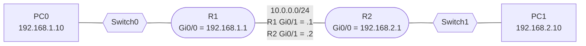

# Routing Tables and Static Routing

**Date:** 2026-10-29
**Tool:** Cisco Packet Tracer
**Builds on:** router vs switch, IP addressing, default gateway, ARP

---

## Goal

Understand what a routing table is and how a router picks the next hop, then connect two LANs through two routers using static routes, and troubleshoot a connectivity failure.

---

## 1. What a routing table is

A **routing table** is the list a router checks for every packet. It answers one question: *"For this destination IP, where do I send it next?"*

Each router decides only its own **next hop** and trusts the next router to do the same.

```
Router# show ip route

C    192.168.1.0/24 is directly connected, GigabitEthernet0/0
L    192.168.1.1/32 is directly connected, GigabitEthernet0/0
C    10.0.0.0/24 is directly connected, GigabitEthernet0/1
S    192.168.2.0/24 [1/0] via 10.0.0.2
```

| Part | Meaning |
|---|---|
| `C`, `L`, `S`, `O` | How the route was learned |
| `192.168.2.0/24` | Destination network |
| `[1/0]` | Administrative distance / metric |
| `via 10.0.0.2` | **Next hop**: the neighbouring router's IP |
| `GigabitEthernet0/1` | Exit interface |

### Where routes come from

| Source | Code | How it gets there |
|---|---|---|
| Connected | `C` | Automatic, for every interface that is up with an IP |
| Local | `L` | The router's own address (a /32) |
| Static | `S` | Typed by hand: `ip route <network> <mask> <next-hop>` |
| Dynamic | `O`, `R`, `D` | Learned from other routers (OSPF, RIP, EIGRP) |

---

## 2. How the router picks a route

When several routes match a destination, three rules apply, in order:

1. **Longest prefix match:** the most specific route wins (`/24` beats `/16` beats `/0`).
2. **Lowest administrative distance:** if different sources offer the same prefix, the more trusted one wins (connected 0, static 1, OSPF 110, RIP 120).
3. **Lowest metric:** if the same protocol offers several paths to the same prefix, the cheapest wins.

For a packet to `10.1.1.5`, the route `10.1.1.0/24` beats `10.1.0.0/16`, `10.0.0.0/8` and `0.0.0.0/0`, even though all four match.

### The default route

`0.0.0.0/0` matches every address but is the least specific, so it is used only when nothing better matches. This is how a home router sends all internet traffic to the ISP: "if I do not know, send it there." It shows as the **gateway of last resort**.

### After choosing a route

1. Find the next hop (or deliver directly if the network is connected).
2. ARP for the next hop's MAC.
3. Rewrite the frame: new source MAC (own), new destination MAC (next hop).
4. Decrement the **TTL** by 1.
5. Send it out the exit interface.

**IP addresses never change. MAC addresses change at every hop.**

### If nothing matches

With no matching route and no default route, the router **drops the packet** and sends back an ICMP "destination unreachable."

---

## 3. Lab topology



| Device | Interface | IP address | Gateway |
|---|---|---|---|
| PC0 | NIC | 192.168.1.10/24 | 192.168.1.1 |
| R1 | Gi0/0 | 192.168.1.1/24 | n/a |
| R1 | Gi0/1 | 10.0.0.1/24 | n/a |
| R2 | Gi0/1 | 10.0.0.2/24 | n/a |
| R2 | Gi0/0 | 192.168.2.1/24 | n/a |
| PC1 | NIC | 192.168.2.10/24 | 192.168.2.1 |

---

## 4. Configuration

**R1**

```
hostname R1
interface gi0/0
 ip address 192.168.1.1 255.255.255.0
 no shutdown
interface gi0/1
 ip address 10.0.0.1 255.255.255.0
 no shutdown
ip route 192.168.2.0 255.255.255.0 10.0.0.2
```

**R2**

```
hostname R2
interface gi0/0
 ip address 192.168.2.1 255.255.255.0
 no shutdown
interface gi0/1
 ip address 10.0.0.2 255.255.255.0
 no shutdown
ip route 192.168.1.0 255.255.255.0 10.0.0.1
```

Read the static route as: *"To reach network 192.168.2.0/24, send packets to next hop 10.0.0.2."*

> **Routes are needed in both directions.** A ping needs a path out *and* a path back. If only one router knows the far network, the request arrives but the reply is dropped.

---

## 5. What I observed

### Before static routes

`show ip route` on each router contained only `C` and `L` routes: a router knows only the networks attached to its own interfaces. Neither router had an entry for the far LAN, so a ping across the routers could not work.

### After static routes

R1 gained one line:

```
S    192.168.2.0/24 [1/0] via 10.0.0.2
```

`S` means static, `[1/0]` is administrative distance 1 and metric 0, and `via 10.0.0.2` is the next hop.


---

## 6. Troubleshooting log: the swapped cables

### Symptom

- `ping 192.168.1.1` from PC0 worked (TTL=255, a router's starting value).
- `ping 192.168.2.10` from PC0 timed out.
- `tracert 192.168.2.10` showed hop 1 as `192.168.1.1`, then only `* * *` for every later hop.

### What I checked

| Check | Result |
|---|---|
| `show ip route` on R1 | Static route to 192.168.2.0/24 present and correct |
| `show ip route` on R2 | Static route to 192.168.1.0/24 present and correct |
| `show ip interface brief` on R2 | Gi0/0 = 192.168.2.1 and Gi0/1 = 10.0.0.2, both `up up` |
| `ping 10.0.0.2` from R1 | **Failed, 0/5**, even after R2 was fully configured |

Every address, mask and route was right, and both ends of the link showed `up up`, yet R1 could not reach R2's directly connected address.

### Root cause

```
show cdp neighbors     (on R1)
```

R2 appeared with **Port ID `Gig 0/0`** instead of the expected `Gig 0/1`. The two cables on R2 were **swapped**:

```
Intended: R1 Gi0/1 (10.0.0.1)  ---  R2 Gi0/1 (10.0.0.2)
Actual:   R1 Gi0/1 (10.0.0.1)  ---  R2 Gi0/0 (192.168.2.1)   <- different subnet
```

R1's ARP request for `10.0.0.2` reached an interface in a different subnet, so nothing replied.

### Fix

Corrected the cabling so that R1 Gi0/1 connects to R2 Gi0/1, and R2 Gi0/0 connects to Switch1. After that, `ping 10.0.0.2` from R1 worked and PC0 could reach PC1.

`tracert 192.168.2.10` from PC0 then showed:

```
1   192.168.1.1     <- R1
2   10.0.0.2        <- R2
3   192.168.2.10    <- PC1
```


### Lesson

> **An interface being `up up` does not mean it is cabled to the right place.** When IPs, masks and routes all look correct but pings still fail, run `show cdp neighbors` to see what is physically connected to each port.

---

## 7. Key takeaways

1. A router knows only **directly connected networks** until it is given other routes, by hand or by a routing protocol.
2. The routing table maps **destination network to next hop**, and each router decides only its own next hop.
3. **Longest prefix match** comes first, then lowest administrative distance, then lowest metric.
4. Static routes must exist **in both directions**.
5. Missing route gives "destination unreachable", while a broken link or wrong cabling gives silent timeouts.
6. Debug in layers: PC to gateway, then router to router, then routes, then physical cabling.

---

## 8. Self-check

1. What does `S 192.168.2.0/24 [1/0] via 10.0.0.2` tell you?
2. A packet matches `10.0.0.0/8`, `10.1.0.0/16` and `0.0.0.0/0`. Which is used?
3. Why does a ping fail if only R1 has a route to the far LAN?
4. What does a router do when no route matches and there is no default route?
5. Both ends of a link are `up up`, but the routers cannot ping each other. What command do you run?

<details>
<summary>Answers</summary>

1. A static route to 192.168.2.0/24 with administrative distance 1 and metric 0, sending traffic to next hop 10.0.0.2.
2. `10.1.0.0/16`, the longest matching prefix among those listed.
3. The request arrives, but the far router has no route back, so the reply is dropped.
4. It drops the packet and sends back an ICMP destination unreachable.
5. `show cdp neighbors`, to check what each port is actually connected to.

</details>

---

## 9. Going further (not yet done)

These are next steps. Add them to the lab only once completed.

**Default route.** On R1, replace the specific route with a default route:

```
no ip route 192.168.2.0 255.255.255.0 10.0.0.2
ip route 0.0.0.0 0.0.0.0 10.0.0.2
```

`show ip route` should then show `Gateway of last resort is 10.0.0.2` and an `S*` entry. PC1 should stay reachable, because R1 now sends everything it has no better route for to R2. R1 only has one way out, so a default route fits.

**Other ideas:**

- Add a third router and watch longest prefix match choose between two routes.
- Replace static routes with OSPF and compare the routing tables.
- Add a backup static route with a higher administrative distance (a floating static route).
