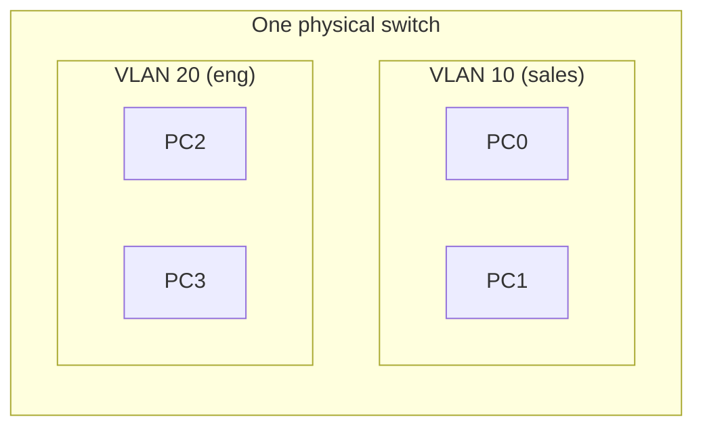
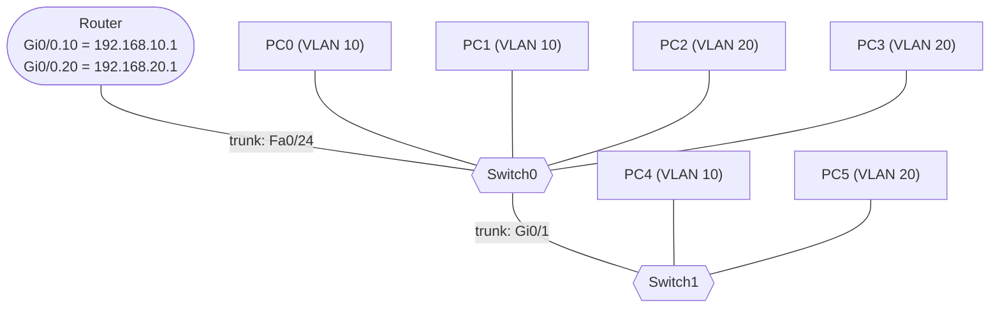

# VLANs, Trunking and Inter-VLAN Routing

**Date:** 2026-10-29
**Tool:** Cisco Packet Tracer
**Builds on:** switch vs router, MAC/IP/ARP, broadcast domains

---

## Goal

Split one physical network into separate logical networks (VLANs), extend them across two switches with a trunk, and let them communicate through a router (router-on-a-stick).

---

## 1. The concept

By default, every port on a switch is in one **broadcast domain**: everyone hears everyone's broadcasts, and everyone can reach everyone. A **VLAN (Virtual LAN)** lets one physical switch behave like several separate switches.

> **One VLAN = one broadcast domain = (normally) one IP subnet.**



**Why split a network?**

| Reason | Benefit |
|---|---|
| Security | Guests or other departments cannot reach sensitive devices |
| Smaller broadcast domains | ARP and other broadcasts stay inside the VLAN |
| Organization | Group by function, not by where the cable runs |
| Flexibility | Move a device to another VLAN with a config change, not new cabling |

### Access port vs trunk port

| | Access port | Trunk port |
|---|---|---|
| Connects | An end device (PC, printer) | Switch to switch, or switch to router |
| VLANs carried | One | Many, at the same time |
| Frames | Untagged | Tagged with an **802.1Q** VLAN ID |
| Command | `switchport mode access` | `switchport mode trunk` |

On a trunk, each frame gets a small 802.1Q tag stating which VLAN it belongs to. The receiving switch reads the tag, delivers the frame only inside that VLAN, and removes the tag before it reaches the PC. The PC never knows VLANs exist.

### Why different VLANs need a router

Different VLANs are different networks. Only a Layer 3 device moves traffic between networks. With **router-on-a-stick**, one router port connects to a trunk and is divided into **sub-interfaces**, one per VLAN. Each sub-interface is the **default gateway** for its VLAN.

> The trunk is the **road** that carries many VLANs. The router is the **junction office** that moves traffic between them.

---

## 2. Final topology



### Addressing plan

| Device | Switch port | VLAN | IP address | Gateway |
|---|---|---|---|---|
| PC0 | Switch0 Fa0/1 | 10 (sales) | 192.168.10.10/24 | 192.168.10.1 |
| PC1 | Switch0 Fa0/2 | 10 (sales) | 192.168.10.11/24 | 192.168.10.1 |
| PC2 | Switch0 Fa0/3 | 20 (eng) | 192.168.20.12/24 | 192.168.20.1 |
| PC3 | Switch0 Fa0/4 | 20 (eng) | 192.168.20.13/24 | 192.168.20.1 |
| PC4 | Switch1 Fa0/1 | 10 (sales) | 192.168.10.14/24 | 192.168.10.1 |
| PC5 | Switch1 Fa0/2 | 20 (eng) | 192.168.20.15/24 | 192.168.20.1 |

The first phases of the lab used a single subnet (192.168.1.x) on purpose, to show that VLAN separation happens at Layer 2 regardless of IP addressing. The PCs were re-addressed per VLAN before adding the router.

---

## 3. Configuration

**Switch0**

```
vlan 10
 name sales
vlan 20
 name eng
interface range fa0/1 - 2
 switchport mode access
 switchport access vlan 10
interface range fa0/3 - 4
 switchport mode access
 switchport access vlan 20
interface gi0/1
 switchport mode trunk
interface fa0/24
 switchport mode trunk
```

**Switch1** (VLANs are defined per switch, so they must be created again)

```
vlan 10
 name sales
vlan 20
 name eng
interface fa0/1
 switchport mode access
 switchport access vlan 10
interface fa0/2
 switchport mode access
 switchport access vlan 20
interface gi0/1
 switchport mode trunk
```

**Router**

```
interface gi0/0
 no shutdown
interface gi0/0.10
 encapsulation dot1q 10
 ip address 192.168.10.1 255.255.255.0
interface gi0/0.20
 encapsulation dot1q 20
 ip address 192.168.20.1 255.255.255.0
```

---

## 4. Verification commands

| Command | What it shows |
|---|---|
| `show vlan brief` | Which ports belong to which VLAN |
| `show interfaces trunk` | Trunk ports, encapsulation, allowed and active VLANs |
| `show ip interface brief` | Interface and sub-interface status and IPs |
| `ipconfig` (on a PC) | The PC's IP, mask and gateway |
| `tracert <ip>` (on a PC) | The path a packet takes |

---

## 5. Lab results

| Stage | Test | Result | Why |
|---|---|---|---|
| No VLANs | PC to PC (all in 192.168.1.x) | All pings work | One broadcast domain |
| VLANs created | PC0 to PC1 (both VLAN 10) | Works | Same VLAN |
| VLANs created | PC0 to PC2 (VLAN 10 vs 20, same subnet) | **Fails** | VLANs separate at Layer 2, before IP matters |
| Trunk added | PC0 to PC4 (both VLAN 10, other switch) | Works | Same VLAN carried over the trunk |
| Trunk added | PC0 to PC5 (VLAN 10 vs 20) | Fails | Different VLANs |
| Router added | PC0 to PC2 | **Works**, TTL=127 | Routed between VLANs |

TTL=127 on the reply shows one router hop: Windows PCs start at 128, and the router subtracts 1.

`tracert 192.168.20.12` from PC0 showed two hops:

```
1   192.168.10.1    <- router (VLAN 10 gateway)
2   192.168.20.12   <- PC2
```


---

## 6. How a packet crosses VLANs

PC0 (VLAN 10) pings PC5 (VLAN 20). PC0 sees that PC5 is in a different subnet, so it sends the frame to its **default gateway**, not to PC5.

| Stage | Source IP | Dest IP | Source MAC | Dest MAC | VLAN tag |
|---|---|---|---|---|---|
| PC0 to switch | PC0 | PC5 | PC0 | Router | none |
| Switch to router (trunk) | PC0 | PC5 | PC0 | Router | VLAN 10 |
| Router to switch (trunk) | PC0 | PC5 | Router | PC5 | VLAN 20 |
| Switch to PC5 | PC0 | PC5 | Router | PC5 | none |

- **IP addresses never change.**
- **MAC addresses are rewritten at the router.**
- **The VLAN tag changes from 10 to 20**, and exists only on trunk links.

---

## 7. Troubleshooting log: what broke and how I fixed it

### Problem 1: PC0 could not ping PC4 across the trunk

- **Symptom:** 100% timeouts, three attempts in a row, so not just the normal ARP first-ping delay.
- **Checked:** `show interfaces trunk` on both switches. Both showed `Gig0/1 trunking`, with VLANs 1, 10 and 20 active. The trunk was fine.
- **Checked:** `show vlan brief` on Switch1. VLAN 10 had **no ports**, Fa0/1 was under **VLAN 20**, and Fa0/2 was still in the default VLAN.
- **Root cause:** PC4's access port was in the wrong VLAN, so VLAN 10 traffic arrived over the trunk but had no port to be delivered to.
- **Fix:** re-applied `switchport access vlan 10` on Fa0/1 and `switchport access vlan 20` on Fa0/2.

### Problem 2 (deliberate break): PC0 moved to the wrong VLAN

- **Break:** on Switch0, `interface fa0/1`, `switchport access vlan 20`.
- **Symptom:** PC0 could not reach PC1, its gateway, or PC2.
- **Why:** PC0 sat in VLAN 20 but kept a 192.168.10.x address and gateway. Its traffic could not reach VLAN 10, and VLAN 20 had no device that matched its addressing.
- **Diagnosis:** `show vlan brief` showed Fa0/1 under VLAN 20.
- **Fix:** put the port back in VLAN 10.

### Problem 3 (deliberate break): trunk shut down

- **Break:** on Switch0, `interface gi0/1`, `shutdown`.
- **Symptom:** PCs on Switch0 kept working, but PC4 and PC5 on Switch1 became unreachable, including from the router.
- **Why:** the trunk is the only path to Switch1, and the router is attached to Switch0.
- **Diagnosis:** `show interfaces trunk` no longer listed Gi0/1, and `show ip interface brief` showed `administratively down`.
- **Fix:** `no shutdown` on Switch0 Gi0/1.

---

## 8. Key takeaways

1. A PC's **switch port VLAN, IP subnet and default gateway must all agree**. If one is wrong, that PC breaks.
2. Two PCs in the **same subnet** but different VLANs cannot talk. VLANs separate at Layer 2.
3. **VLANs are defined per switch.** A new switch needs the same VLANs created.
4. A trunk must be configured on **both ends**.
5. **Same-switch traffic fine, cross-switch traffic broken** points to the trunk. **One PC broken** points to its port VLAN, IP or gateway.
6. Inter-VLAN traffic needs a Layer 3 device, and each VLAN's gateway is a router sub-interface (or a Layer 3 switch interface).

---

## 9. Self-check

1. Why can PC0 not reach PC2 even though both are in 192.168.1.x?
2. What is the difference between an access port and a trunk port?
3. What does the 802.1Q tag do, and where is it removed?
4. Why does the router need sub-interfaces?
5. A single PC cannot reach anything. What do you check first?

<details>
<summary>Answers</summary>

1. They are in different VLANs, which are separate broadcast domains. The switch will not forward between them regardless of IP addressing.
2. An access port carries one VLAN for an end device. A trunk carries many VLANs between switches or to a router, using tags.
3. It labels each frame with its VLAN on trunk links. The switch removes it before delivering the frame to an access port.
4. One physical cable carries several VLANs, and each sub-interface is the gateway for one of them.
5. The switch port's VLAN (`show vlan brief`), then the PC's IP, mask and gateway.

</details>

---

## 10. What I would do next

- Add DHCP per VLAN so PCs get the right IP and gateway automatically.
- Replace the router with a Layer 3 switch using SVIs.
- Restrict VLAN access with ACLs between sales and eng.
