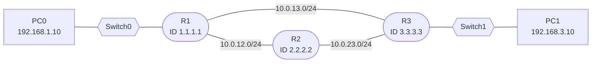

# Dynamic Routing with OSPF

**Date:** 2026-10-30
**Tool:** Cisco Packet Tracer
**Builds on:** routing tables, static routing, administrative distance, STP path cost

---

## Goal

Understand how dynamic routing protocols work, build a three-router network where OSPF discovers neighbors and learns routes automatically, and watch traffic reroute when a link fails, which static routes cannot do.

---

## 1. Why dynamic routing

| Static routing | Dynamic routing |
|---|---|
| Every route typed by hand on every router | Routers learn routes from each other |
| Many networks means a lot of typing | Add a network once and everyone learns it |
| A failed link keeps receiving traffic | Routers detect the failure and switch paths |
| No protocol traffic, predictable | Uses CPU, memory and bandwidth for updates |

Every dynamic protocol does four things:

1. **Discover neighbors:** find directly connected routers.
2. **Exchange routes:** tell neighbors which networks it knows.
3. **Choose the best path:** compare metrics and pick the lowest.
4. **React to changes:** detect failures and recalculate. The time this takes is **convergence**.

### Types of protocols

| Category | Protocols | Used |
|---|---|---|
| **IGP** (interior) | RIP, OSPF, EIGRP, IS-IS | Inside one organization |
| **EGP** (exterior) | BGP | Between organizations, the internet backbone |

| | Distance vector | Link-state |
|---|---|---|
| Examples | RIP (EIGRP is a hybrid) | **OSPF**, IS-IS |
| What a router knows | Only what its neighbors report | The **complete map** of its area |
| Analogy | Routing by rumor | Everyone holds the same map |
| Convergence | Slower | Faster |
| Metric | Hop count (RIP) | Cost based on bandwidth |
| Administrative distance | RIP 120 | OSPF 110 |

---

## 2. How OSPF works

OSPF (Open Shortest Path First) is a **link-state** protocol:

1. Each router describes its own links in a **Link-State Advertisement (LSA)**.
2. LSAs are **flooded** to every router in the area.
3. Every router stores them in the same **link-state database (LSDB)**: a shared map.
4. Each router runs the **SPF algorithm (Dijkstra)** on that map, with itself as the root, to find the shortest path to every network.
5. The results go into the routing table, marked `O`.

Because every router holds the same map, they agree on the topology and converge quickly.

### Metric: cost

```
Cost = reference bandwidth / interface bandwidth
```

With the default reference bandwidth of 100 Mbps, FastEthernet and Gigabit links both cost 1. The router adds up the costs along each path and picks the lowest total. This is the same idea as STP path cost.

---

## 3. Neighbor relationships

Routers do not exchange routes with just anyone. They first become **neighbors** by exchanging **Hello packets**.

- Hellos go every **10 seconds** (on Ethernet) to multicast `224.0.0.5`.
- If no Hello arrives within the **dead interval (40 seconds)**, the neighbor is declared down.
- Each router has a **Router ID**, a unique 32-bit number written like an IP. It is chosen from a manual `router-id`, else the highest loopback IP, else the highest active interface IP.

### Neighbor states

```
Down -> Init -> 2-Way -> ExStart -> Exchange -> Loading -> Full
```

| State | Meaning |
|---|---|
| Down | No Hellos received |
| Init | I received your Hello, but you have not seen mine yet |
| 2-Way | Both routers see their own ID in the other's Hello. A true neighbor |
| ExStart / Exchange | Choosing who leads, then swapping database summaries |
| Loading | Requesting missing LSAs |
| **Full** | Databases identical: fully **adjacent**, ready to route |

**Neighbor vs adjacency:** neighbors have exchanged Hellos (2-Way). Adjacent routers have synchronized databases (Full).

### What must match for routers to become neighbors

| Must match | Notes |
|---|---|
| **Area ID** | Different areas on one link means no neighbor |
| **Subnet and mask** | Both interfaces must be in the same subnet |
| **Hello and dead timers** | A mismatch means Hellos are rejected |
| **Authentication** | Only if it is configured; type and key must match |
| **Network type** | Must be compatible (broadcast vs point-to-point) |

| Must differ | Notes |
|---|---|
| **Router ID** | Must be unique |

| Special case | Notes |
|---|---|
| **MTU** | A mismatch does not stop the neighbor forming, but routers get **stuck in ExStart** and never reach Full |
| **Process ID** (`router ospf 1`) | Local only. It does **not** need to match |

Memory trick: **A-S-T-A**. **A**rea, **S**ubnet, **T**imers, **A**uthentication match. Router ID is unique. MTU decides whether you reach Full.

### DR and BDR

On a shared segment, OSPF elects a **Designated Router (DR)** and **Backup DR (BDR)** so that routers synchronize with the DR instead of with every other router. Highest priority wins (default 1), then highest router ID. The election is not pre-emptive.

> **Ethernet links default to the broadcast network type**, so even a link with only two routers elects a DR and BDR. That is why `show ip ospf neighbor` shows `FULL/DR` or `FULL/BDR` on every link in this lab. The election is skipped only if the network type is set to point-to-point.

---

## 4. Areas

In a large network, every router holding the entire map means large databases, SPF recalculations triggered by a flapping link anywhere, and LSAs flooded everywhere. OSPF solves this by dividing the network into **areas**.

| Rule | Meaning |
|---|---|
| **Area 0 is the backbone** | Every other area must connect to it |
| **Detail stays inside the area** | A flapping link in one area does not make other areas recompute |
| **ABRs summarize** | The router between areas shares summaries, not the whole map |

| Router role | Description |
|---|---|
| Internal router | All interfaces in one area |
| Backbone router | At least one interface in Area 0 |
| **ABR** (Area Border Router) | Interfaces in more than one area |
| **ASBR** (AS Boundary Router) | Connects to another routing domain and redistributes routes |

This lab uses a single area (Area 0), which is the normal choice for small networks.

---

## 5. Lab topology



### Cabling

| From | Port | To | Port |
|---|---|---|---|
| PC0 | FastEthernet0 | Switch0 | Fa0/2 |
| Switch0 | Fa0/1 | R1 | Gi0/0 |
| R1 | Gi0/1 | R2 | Gi0/0 |
| R1 | Gi0/2 | R3 | Gi0/1 |
| R2 | Gi0/1 | R3 | Gi0/2 |
| R3 | Gi0/0 | Switch1 | Fa0/1 |
| Switch1 | Fa0/2 | PC1 | FastEthernet0 |

### Addressing plan

| Link | Network | Left side | Right side |
|---|---|---|---|
| PC0 LAN | 192.168.1.0/24 | R1 Gi0/0 = .1 | PC0 = .10 |
| R1 to R2 | 10.0.12.0/24 | R1 Gi0/1 = .1 | R2 Gi0/0 = .2 |
| R1 to R3 | 10.0.13.0/24 | R1 Gi0/2 = .1 | R3 Gi0/1 = .3 |
| R2 to R3 | 10.0.23.0/24 | R2 Gi0/1 = .2 | R3 Gi0/2 = .3 |
| PC1 LAN | 192.168.3.0/24 | R3 Gi0/0 = .1 | PC1 = .10 |

PC0 uses gateway 192.168.1.1, and PC1 uses gateway 192.168.3.1.

---

## 6. Configuration

**Interfaces** (R1 shown; R2 and R3 follow the addressing plan)

```
hostname R1
interface gi0/0
 ip address 192.168.1.1 255.255.255.0
 no shutdown
interface gi0/1
 ip address 10.0.12.1 255.255.255.0
 no shutdown
interface gi0/2
 ip address 10.0.13.1 255.255.255.0
 no shutdown
```

**OSPF**

```
! R1
router ospf 1
 router-id 1.1.1.1
 network 192.168.1.0 0.0.0.255 area 0
 network 10.0.12.0 0.0.0.255 area 0
 network 10.0.13.0 0.0.0.255 area 0

! R2
router ospf 1
 router-id 2.2.2.2
 network 10.0.12.0 0.0.0.255 area 0
 network 10.0.23.0 0.0.0.255 area 0

! R3
router ospf 1
 router-id 3.3.3.3
 network 192.168.3.0 0.0.0.255 area 0
 network 10.0.13.0 0.0.0.255 area 0
 network 10.0.23.0 0.0.0.255 area 0
```

- `router-id` is set **before** the `network` lines.
- `network X wildcard area 0` means: run OSPF on every interface whose IP falls in this range, and put it in Area 0.
- The wildcard mask is the inverse of the subnet mask (`255.255.255.0` becomes `0.0.0.255`).

### Verification commands

| Command | What it shows |
|---|---|
| `show ip ospf neighbor` | Neighbors and state (you want **FULL**) |
| `show ip route` | OSPF routes marked `O`, with `[110/cost]` |
| `show ip protocols` | Router ID and the networks OSPF is running on |
| `show ip ospf interface brief` | Interfaces in OSPF, with area and cost |
| `show cdp neighbors` | What is physically cabled to each port |

---

## 7. Results

### Before OSPF

`show ip route` on R1 listed only `C` (connected) and `L` (local) entries, with `Gateway of last resort is not set`. R1 had no route to `10.0.23.0/24` or `192.168.3.0/24`, so it could not reach R3's LAN.


### After OSPF

- `show ip ospf neighbor` on R1 showed two neighbors, both **FULL**.
- `show ip route` showed new `O` routes with administrative distance 110.
- PC0 could ping PC1.

Costs worked out as follows (each Gigabit link is cost 1):

| Destination from R1 | Path | Total cost |
|---|---|---|
| 192.168.3.0/24 | R1 to R3, then R3's LAN | 2 |
| 192.168.3.0/24 | R1 to R2 to R3, then R3's LAN | 3 (not chosen) |
| 10.0.23.0/24 | Via R2 or via R3 | 2 and 2 (**equal-cost multipath**, both installed) |

`tracert 192.168.3.10` from PC0 took the direct path through R3:

```
1   192.168.1.1     <- R1
2   10.0.13.3       <- R3
3   192.168.3.10    <- PC1
```


### Failover test

1. Started a continuous ping from PC0 to PC1 (`ping -t 192.168.3.10`).
2. Shut down R1's link to R3: `interface gi0/2`, `shutdown`.
3. The ping timed out briefly, then recovered on its own.
4. R1 then had a single neighbor (R2), and `tracert` showed the longer path:

```
1   192.168.1.1     <- R1
2   10.0.12.2       <- R2
3   10.0.23.3       <- R3
4   192.168.3.10    <- PC1
```

5. Restoring the link with `no shutdown` brought traffic back to the direct path.

No one edited a route. OSPF detected the failure and recalculated by itself.


---

## 8. Troubleshooting guide

| `show ip ospf neighbor` shows | Likely cause |
|---|---|
| Nothing | `network` statement missing or wrong, interface down, or area/subnet/timer mismatch |
| Stuck in **Init** | Hellos travelling one way only: check cabling and ACLs |
| Stuck in **ExStart** | MTU mismatch |
| **2-Way** on a segment with several routers | Normal for non-DR routers |
| Flapping | Unstable link or mismatched dead timer |

Carried over from the static routing lab: an interface being `up up` does not prove it is cabled to the right place. If the configuration looks right but nothing forms, `show cdp neighbors` shows what each port is actually connected to.

If a static route and an OSPF route exist for the same network, the static route wins, because its administrative distance (1) is lower than OSPF's (110). Remove old static routes (`no ip route ...`) when switching to OSPF.

---

## 9. Key takeaways

1. Dynamic routing lets routers discover each other and share routes. It also reroutes around failures.
2. OSPF is link-state: every router builds the same map (LSDB) and runs SPF to find the shortest path.
3. Neighbors form through Hellos. **Area, subnet, timers and authentication must match, and router IDs must differ.** An MTU mismatch blocks the adjacency, not the neighbor.
4. The goal state is **FULL**.
5. The best path is the lowest total **cost**. Equal costs give equal-cost multipath.
6. OSPF routes have **AD 110**, so a static route (AD 1) overrides them.
7. Areas keep large networks manageable. Area 0 is the backbone, and ABRs connect other areas to it.

---

## 10. Self-check

1. What must match between two routers for them to become OSPF neighbors, and what must differ?
2. Why did OSPF choose the direct path to R3, and what does cost 2 mean?
3. What is the difference between a neighbor (2-Way) and an adjacency (Full)?
4. Why can a static route with AD 1 override an OSPF route with AD 110?
5. Why does a link with only two routers still show a DR or BDR?
6. Two routers reach 2-Way but never Full. What is the most likely cause?

<details>
<summary>Answers</summary>

1. Area ID, subnet and mask, hello/dead timers, authentication (if used) and a compatible network type must match. Router IDs must be unique. The process ID does not need to match.
2. It is the lowest total cost: 1 (R1 to R3) plus 1 (R3's LAN) equals 2, against 3 via R2.
3. Neighbors have exchanged Hellos. Adjacent routers have also synchronized their databases.
4. The router trusts the lower administrative distance first, so the static route is installed and the OSPF route is not.
5. Ethernet defaults to the broadcast network type, which elects a DR and BDR even with two routers.
6. An MTU mismatch, which leaves them stuck in ExStart.

</details>

---

## 11. Going further (not yet done)

Add these to the lab only once completed.

- **Cost tuning:** set `ip ospf cost 10` on R1 Gi0/2 to force traffic through R2 on purpose, and compare the routing tables.
- **Break the neighbor rules:** change a hello timer, area or MTU on one side and read what `show ip ospf neighbor` says.
- **Multi-area OSPF:** put R3's LAN in Area 1, making R3 an ABR.
- **Default route:** originate one with `default-information originate`.
